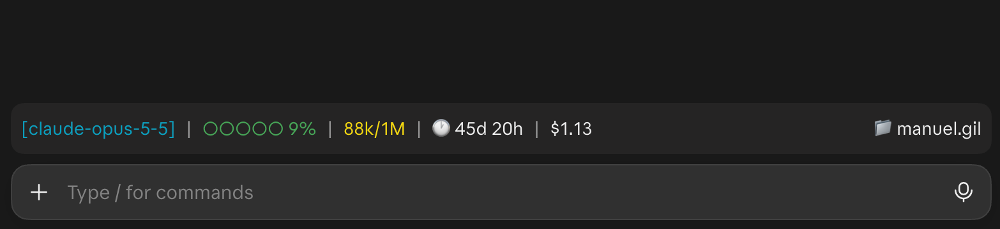

# context-line


A Claude Code mod that draws a band above the prompt. The band shows your session at a glance: the model, how full the context window is, the time, the cost, and where you work.

## Screenshots

Terminal:

<!--  -->

> Screenshot: the band in the terminal. Save it as `images/terminal.png`.

Claude Code desktop app:

<!--  -->

> Screenshot: the band in the desktop app. Save it as `images/desktop.png`.

To add a screenshot, save the file in `images/`, uncomment its image line, and remove the caption below it.

## What it shows

| Item | Example | Meaning |
| --- | --- | --- |
| Model | `[claude-opus-5-5]` | The model that runs the session. |
| Context bar | `●●○○○ 40%` | How much of the context window is in use. Each dot is 20 percent. |
| Tokens | `400k/1M` | Tokens in the context, and the size of the window. |
| Time | `🕐 12m` | The age of the session. |
| Cost | `$1.13` | The cost of the session in US dollars. |
| Folder | `📁 my-project` | The folder where the session runs. |
| Branch | `🌿 main` | The git branch. The mod hides it outside a git repository. |

The bar changes color with the fill of the window.

| Fill | Color |
| --- | --- |
| Below 70 percent | Green |
| 70 to 89 percent | Yellow |
| 90 percent or more | Red |

## Layouts

On a wide terminal, the folder and the branch sit at the right edge, with no separator before them.

On a narrow terminal, all items flow in one row that wraps, with a `|` after each item.

The mod works in the terminal and in the desktop app.

## Install

Clone this repository into your Claude Code skills folder, then start a new session. Claude Code loads the mod and reloads it when you save a file.

```
git clone https://github.com/manugildev/claude-context-line-mod.git ~/.claude/skills/context-line
```

To use the mod in one project only, clone it into `<project>/.claude/skills/context-line`.

### If the band does not show

1. Start a session with `claude --plugin-dir ~/.claude/skills/context-line`.
2. For the desktop app, add this line to the `env` block of `~/.claude/settings.json`, then restart the app:

   ```
   "CLAUDE_CODE_PLUGIN_DIRS": "/Users/<you>/.claude/skills/context-line"
   ```

3. Run `claude plugin validate ~/.claude/skills/context-line` and read the result.

## Update

```
git -C ~/.claude/skills/context-line pull
```

Claude Code reloads the mod when the files change.

## Uninstall

```
rm -rf ~/.claude/skills/context-line
```

Remove the `CLAUDE_CODE_PLUGIN_DIRS` line from `~/.claude/settings.json` if you added it.

## How it works

The mod uses three hooks.

| Hook | What it does |
| --- | --- |
| `session.measure` | Reads the context fill, the cost, the model, the folder, and the git branch each time usage changes. |
| `turn.complete` | Updates the model name when a turn finishes. |
| `ui.render` on `AbovePrompt` | Draws the band. It picks the wide or the narrow layout from the space it has. |

The mod keeps its last reading in session state. If it has no reading yet, the render hook reads the figures itself.

## Limits

- The time is the age of the session. For a resumed session, it counts from the first launch, so it can be days.
- The mod estimates text width to choose the layout. If the switch is wrong, change the margin in `hooks/register.tsx`.
- The mod uses named colors. Yellow can be hard to read on some light themes.
- Mods are a new feature and the API can change. If the band stops working after an update, validate the folder as shown above.

## Contribute

Open an issue or a pull request. To try a change, edit `hooks/register.tsx` in your clone. Claude Code reloads the mod, and `claude plugin validate .` checks it.

## License

MIT. See `LICENSE`.
