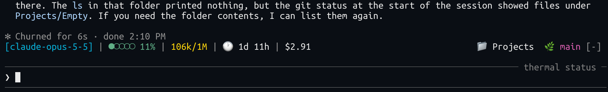

# context-line

A Claude Code mod that shows a band above the prompt with the model, context usage, session time, cost, folder and git branch. It works in the terminal and in the desktop app.

> ### Terminal
>
> 

> ### Claude Code desktop app
>
> 

## What it shows

| Item | Example | Meaning |
| --- | --- | --- |
| Model | `[claude-opus-5-5]` | The model that runs the session. |
| Context bar | `●○○○○ 11%` | How full the context window is. The bar is green, turns yellow at 70 percent, and red at 90 percent. |
| Tokens | `106k/1M` | Tokens in the context, out of the window size. |
| Time | `🕐 1d 11h` | How long ago the session started. |
| Cost | `$2.91` | What the session has cost so far, in US dollars. |
| Folder | `📁 Projects` | The folder where the session runs. |
| Branch | `🌿 main` | The git branch. It is hidden outside a git repository. |

## Install

```
git clone https://github.com/manugildev/claude-context-line-mod.git ~/.claude/skills/context-line
```

Then start a new Claude Code session.

## License

MIT
