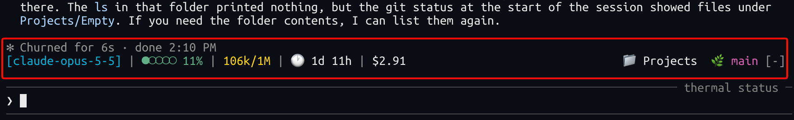

# context-line

A Claude Code mod that draws a band above the prompt: model, context bar, tokens, session time, cost, folder and git branch. It works in the terminal and in the desktop app.

The bar is green below 70 percent, yellow from 70, and red from 90. On a wide terminal, the folder and branch sit at the right edge. On a narrow one, all items wrap in one row.




## Install

```
git clone https://github.com/manugildev/claude-context-line-mod.git ~/.claude/skills/context-line
```

Start a new Claude Code session. If the band does not show, start it with `claude --plugin-dir ~/.claude/skills/context-line`. For the desktop app, add `"CLAUDE_CODE_PLUGIN_DIRS": "/Users/<you>/.claude/skills/context-line"` to the `env` block of `~/.claude/settings.json`.

## Limits

The time is the age of the session, so a resumed session can show days. Mods are a new Claude Code feature, and the API can change.

## License

MIT
